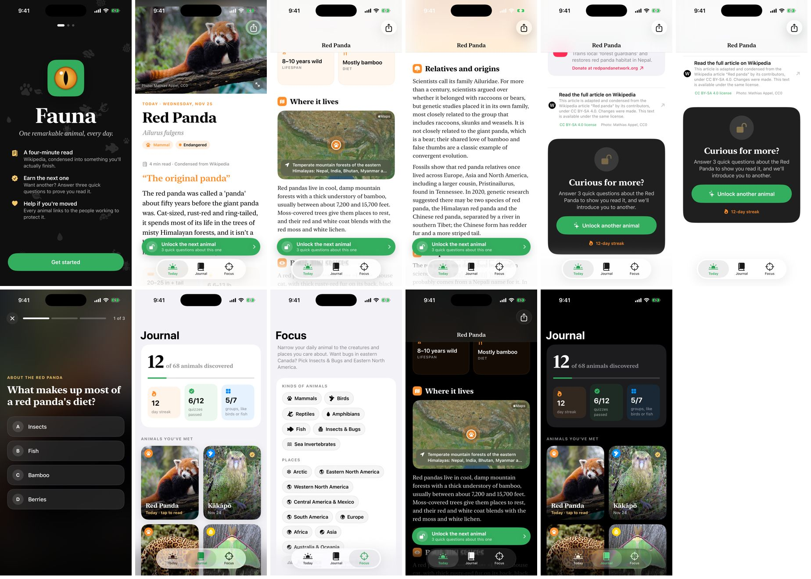

# Fauna

One remarkable animal, every day. A native SwiftUI iPhone app that turns Wikipedia into a two-minute read, sends a daily notification naming the next animal, and makes you prove you read today's before you get another.



## What it does

- **Today.** A full-bleed photo header that stretches and parallaxes, then a condensed article: pull quote, lede, four quick facts, a satellite map of the range, how it lives, what makes it remarkable, a "Did you know?" card, and its IUCN Red List status on a seven-step scale.
- **Earn the next one.** At the end, "Unlock another animal" opens a full-screen quiz of up to three multiple-choice questions. Every answer has to be right. A miss explains the answer and offers "Read it again" or "Try again" (questions and choices reshuffle). Pass, and the next animal slides in.
- **Focus.** Narrow the daily animal by kind (mammals, birds, reptiles, amphibians, fish, insects & bugs, sea invertebrates) and place (11 regions, including Eastern North America, so "bugs in eastern Canada" is two taps). When your focus runs dry, Fauna says so and picks from anywhere.
- **Daily notification.** "Meet the Okapi: the forest giraffe with zebra legs. 2-minute read." at the time you choose. The next 30 days are scheduled with real animal names and rebuilt whenever the queue changes.
- **Help.** Each animal links to one or two real organizations working on it (Xerces Society, Red Panda Network, Snow Leopard Trust, Polar Bears International, and others). Links open the charity's own site in Safari; the app never handles money.
- **Journal.** Animals you've met as photo cards with a seal for passed quizzes, your streak, and blurred, locked tiles for everything still out there.

## Run it

1. Open `Fauna/Fauna.xcodeproj` in Xcode 16 or later (the project uses folder-synced groups, so new files in `Fauna/Fauna/` are picked up automatically).
2. Pick your team under **Signing & Capabilities** and change the bundle ID (placeholder: `com.fauna.daily`).
3. Run on an iPhone or simulator (iOS 17+). Photos need a network connection the first time; they're cached after that.

Launch arguments for demos and screenshots: `-FaunaDemo` (sample history), `-FaunaTab journal|focus`, `-FaunaQuiz`, `-FaunaScrollTo facts|didYouKnow|help|unlock`, `-FaunaOnboarding`.

CI (`.github/workflows/fauna.yml`) validates the content, checks every Wikipedia title still has a photo, builds for the simulator, and commits fresh screenshots to `Fauna/docs/screenshots/`.

## Layout

```
Fauna/
  App/          FaunaApp (entry, root, tabs)
  Model/        Animal and its taxonomy (groups, regions, IUCN status)
  Store/        AppStore: daily rollover, queue, unlocks, journal, streak, JSON persistence
  Services/     WikiImages (Wikipedia REST → Wikimedia thumbnails, cached), Reminders (notifications)
  Views/        Today (article), Quiz, Journal, Focus, Onboarding, Components (theme, chips, map, scale)
  Resources/    animals.json (38 animals, 114 questions), assets, privacy manifest
scripts/        validate_content.py, make_icon.py
```

## Decisions I made without asking

- **Name:** Fauna. **Platform:** iOS 17+, iPhone, SwiftUI, no third-party code, no backend, no accounts, no analytics.
- **Content is bundled, photos are live.** Wikipedia articles are condensed by hand into `animals.json` (about 300 words each, plus facts, questions, and charities), because generating readable summaries and fair quiz questions on-device isn't reliable. Lead photos come from the Wikipedia REST API at a standard Wikimedia width and are cached on disk. Adding an animal is a JSON edit; `scripts/validate_content.py` checks it.
- **The quiz requires all answers right**, since the point is proving you read it. Retries are unlimited and reshuffled. Questions are written to be answerable from the article alone.
- **One daily animal, unlimited bonus animals** as long as you keep passing quizzes. Bonus animals come from the same queue, so the notification schedule is rebuilt after each unlock.
- **"Day" is the device's local calendar day.** The app rolls over at midnight, on launch, and when it returns to the foreground.
- **Donations open in Safari** rather than in-app, to stay clearly inside App Store rules for charitable giving.
- **Attribution:** article text is a condensed adaptation of Wikipedia (CC BY-SA 4.0), photos are from Wikimedia Commons; both are credited under every article with a link to the source. Per-photo author credits are a good next step before an App Store release.

## Next steps

- A home-screen widget showing today's animal.
- Per-photo author and license credits from the Commons API.
- More animals (the format is designed for hundreds), especially fish, insects and regional sets like the Great Lakes or the Maritimes.
- A server-side pipeline that drafts new entries from Wikipedia for human review.
